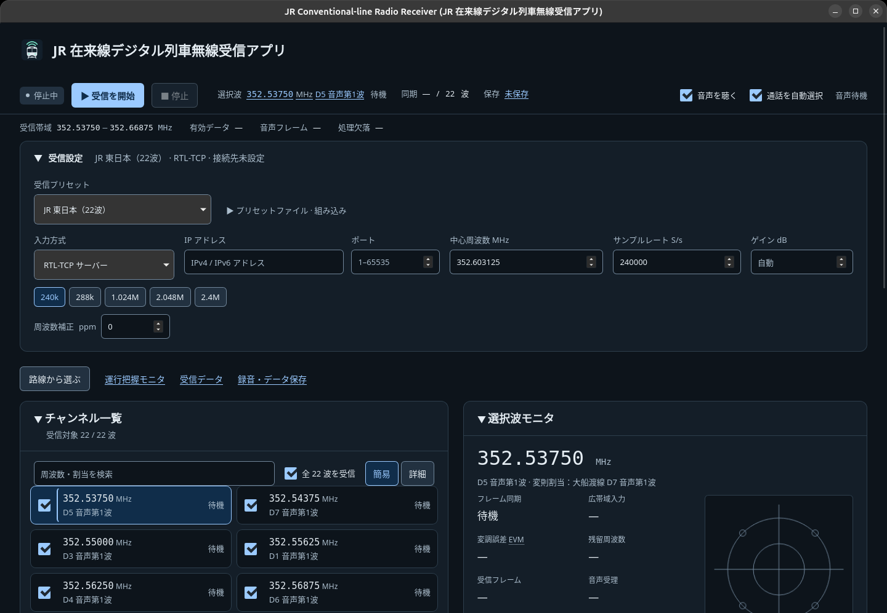

# JR Conventional-line Radio Receiver

English | [日本語](README.ja.md)

Version: **v1.7.0**

Author: KIRISHIKI Yudai <yudai.kirishiki@protonmail.com>

A desktop receiver for digital train radio on JR conventional lines, built with Rust, Tauri 2, and SoapySDR.
It **demodulates 22 channels at once from one wideband IQ stream and decodes each channel's voice and data independently**.
The interface is in Japanese; this guide gives each on-screen label with its English meaning.
“バージョン情報” (About), at the bottom of the window, shows the product name, version, and author.



## Getting started

Install stable Rust, the **SoapySDR 0.8 development libraries**, the SoapySDR module for your hardware,
and the [Tauri prerequisites for your OS](https://v2.tauri.app/start/prerequisites/).
The frontend is plain HTML, CSS, and JavaScript, so building and running the app needs no Node.js or npm.
The UI tests use Node.js 24.15 or later and `npm ci`.

Ubuntu / Debian example (package names vary by distribution):

```sh
sudo apt install build-essential pkg-config libsoapysdr-dev soapysdr-tools \
  libwebkit2gtk-4.1-dev libgtk-3-dev librsvg2-dev libssl-dev
# Add the module for your device, such as soapysdr-module-rtlsdr.
cargo run --release -p jr-receiver-desktop
```

Use `--release` for reception. `Cargo.lock` is committed.
GitHub Actions builds GUI and CLI binaries for Linux x86_64, Windows x64, and macOS Apple Silicon / Intel.
Manual runs only produce artifacts; pushing a tag that matches the version, such as `v1.7.0`, also publishes a GitHub Release.
Windows archives bundle the SoapySDR DLL; Linux and macOS use the system's SoapySDR 0.8.
See the [release guide](docs/RELEASE.md) for builds, runtime dependencies, CI, and publishing.
Local builds and launches have been tested on Linux only. There are no installers, publisher signatures, or notarization.

## Simultaneous reception

[`ui/radio-presets.json`](ui/radio-presets.json) defines channels and receive profiles separately in a custom JSON format, shared by the GUI and CLI as built-in presets.
The desktop app can also load an external file in the same format, without rebuilding.
While stopped, open “受信設定” (Receive settings) → “プリセットファイル” (Preset file) → “JSON ファイルを選択” (Select JSON file).
“再読み込み” (Reload) applies edits; “組み込みに戻す” (Restore built-in) returns to the three built-in operator profiles.

1. Choose an input. For RTL-TCP, enter the server's **IP address and port** (empty on first launch).
   For local hardware, choose “SoapySDR デバイス” (SoapySDR device) and pick one with “検索” (Find).
   Advanced settings take SoapySDR arguments, an RX channel index, and an antenna.
2. In “受信設定”, choose a receive profile, then check the channels to receive. The default is JR East's 22 channels.
   Or use **“路線から選ぶ” (Choose by line)**: search by line, station, or D number, select one or more sections, review their frequencies, and apply. Reception still starts only with “受信を開始”. See [route selection and external route data](docs/ROUTES.md).
   The built-in profiles are JR East (22 channels), JR Central (3), and JR West (19), each with only that operator's frequencies.
   The default “簡易” (Compact) view shows frequency, allocation, and sync state as tiles that fit the window width.
   “詳細” (Detailed) shows format and voice/data counts in a table. Switching views does not affect reception, recording, the selected channel, or the search.
3. The defaults are a center frequency of **352.603125 MHz** and a requested rate of **240,000 S/s**.
   Buttons under the fields set common rates: 240k, 288k, 1.024M, 2.048M, and 2.4M for RTL-TCP; 240k, 250k, 1M, and 2.048M for SoapySDR. The button for the current rate stays pressed.
   If the rate is outside the RTL-TCP ranges or too low to demodulate every enabled channel at the current center, a note below says so and gives the required rate. Starting reception validates the field value.
   SoapySDR checks bandwidth against the rate and center frequency read back from the device.
   RTL-TCP cannot read settings back, so the app shows and uses the requested values.
   Changing profiles sets its center and recommended rate: **352.603125 MHz** for JR East / West,
   **352.625000 MHz** for JR Central, and **240 kS/s** for all three.
   For IQ WAV input, the center frequency you entered is kept.
4. “受信を開始” (Start reception) processes every checked channel. Launching the app does not connect to a server.
   Select a frequency to see its sync state, EVM, constellation, and decoded data.
5. “音声を聴く” (Listen) plays the selected channel. **“通話を自動選択” (Auto-select calls)** is on by default. Both checkboxes sit in the session bar, which stays reachable while scrolling.
   When calls overlap, the one that started first wins; when it ends, the earliest call still active takes over.
   **Selecting a frequency manually pins that channel**, and the monitor shows “手動選択で固定中” (Pinned manually). Turn auto-select back on to resume switching.
   All other channels keep decoding and synthesizing voice; the speaker plays one channel at a time.
6. In “録音・データ保存” (Recording and data output), expand “保存内容・保存先” (Formats and folder) to choose WAV, raw-frame JSONL, or data-message JSONL.
   “保存を開始” (Start saving) saves every channel being received. Only WAV is on by default.
   The status and start/stop buttons stay visible when the section is collapsed.

The constellation and EVM use the signal after receive filtering, timing recovery, carrier correction, and inter-symbol interference cancellation.
That last step uses the sequence detector's current best channel estimate. The plot keeps the received amplitude and phase scatter rather than showing ideal decided symbols.
EVM is an uncalibrated tuning aid, not an SNR or error-rate measurement.

The channels span 352.53750–352.66875 MHz at 6.25 kHz spacing, 131.25 kHz in total.
With the demodulation filter margin, receiving all of them needs a complex sample rate above 139.65 kS/s.
Leave extra margin for your hardware's usable bandwidth and anti-aliasing.
If a device does not support 240 kS/s, choose a higher supported rate such as 1.024 MS/s.
Hardware support depends on the available [SoapySDR drivers](https://github.com/pothosware/SoapySDR/wiki).

### Screen layout

What matters during reception comes first. From the top: the session bar, reception totals, receive settings, the channel list and selected-channel monitor, the operation monitor and received data, and recording.

The session bar holds the state, “受信を開始” (Start) and “停止” (Stop), the selected channel (frequency, allocation, sync state), the synchronized count, the save state, and the two audio checkboxes. The selected channel links to the monitor, and the save state links to the recording section.
On screens wider than 36rem and at least 36rem tall, the bar stays pinned while scrolling, and link and focus targets are offset so it never covers them. Narrow windows drop the allocation name from the bar.
Below it, one line shows the band and running totals of valid data, voice frames, and dropped processing blocks.
“受信設定” is open while stopped and closes when reception starts; its header still names the profile and the input or endpoint.
Search only filters the list; it never changes which channels are received.
The channel list and monitor start open. The monitor leads with the frequency and allocation, then diagnostics and playback settings. Select a header to collapse a panel; reception, audio, and data updates continue.
On wide screens the operation monitor and received data sit side by side, with links to each section above them. The received-data panel names its channel, which links to the channel list.
Preset errors and invalid channel selections open the relevant settings automatically.
“更新を一時停止” (Pause updates) freezes the message log while decoding and the operation monitor continue. On narrow screens the detailed list becomes cards.

### Operation monitor

“運行把握モニタ” (Operation monitor) shows, per line, delayed trains, trains on the line, three delay classes, the maximum delay, and that train's number, from supported JR East common-channel messages. Receive the common channel in the “一斉” format.
It updates independently of audio selection, saving, and the message-log pause. Narrow layouts show each line as a labeled record, and missing values read “不明” (Unknown), not zero.

Message timestamps are not interpreted until the prefix format is known. The monitor shows only the computer's last reception time, labeled “最終受信日時（JST）” (or “最終読取日時（JST）” during IQ WAV playback). That time is not when the information was created, and the table may not reflect current service. No age or ordering is inferred from the prefix.

Complete, validated tables replace the display in reception order. An identical prefix and table update the reception time and repeat count; any change starts a new count. IQ loss keeps the last complete table and its time. A new receive session or a preset change clears it.

The decoder supports the verified `0x22 / C9` common-channel form: an 11-byte prefix, an LH5 archive, and a `0x87` table of seven 21-byte rows. RS/CRC validation and archive header and content checks are required. Other layouts are not guessed from partial data.

### RTL-TCP

RTL-TCP accepts IPv4 or IPv6 addresses and requested rates of 225001–300000 or 900001–3200000 S/s.
An empty gain field selects tuner AGC; a number sets manual gain. The ppm correction must be an integer.
RTL-TCP is an extra Rust TCP input alongside SoapySDR, not a replacement.
The protocol does not report server-side IQ loss or rejected settings. “処理欠落” (Dropped blocks) counts drops in the app's own worker queues only;
it does not prove the server delivered every sample.

## Persistent settings

The desktop app saves changes automatically and restores them at the next launch:

- Input, receive profile, center frequency, sample rate, and gain.
- External preset file path, if any.
- RTL-TCP address, port, and ppm correction.
- SoapySDR device arguments, RX channel, and antenna; IQ WAV file path.
- Whether saving is on, the output folder, and the selected output formats.

Saved center frequencies and rates are not replaced by profile defaults at startup, and deliberately empty fields stay empty.
Startup restores settings only; reception starts when you press start. If saving was on, it resumes once reception is ready.
Closing the window waits for pending writes, including recent edits.

Settings are stored as versioned JSON in `settings.json` in Tauri's app config directory. Source files and presets are never modified.

| OS | Location |
| --- | --- |
| Linux | `$XDG_CONFIG_HOME/io.jrradio.receiver/settings.json`, or `~/.config/io.jrradio.receiver/settings.json` when unset |
| macOS | `~/Library/Application Support/io.jrradio.receiver/settings.json` |
| Windows | `%APPDATA%\io.jrradio.receiver\settings.json` |

Each write goes to a temporary file first, then replaces the original. If a write fails, “保存を再試行” (Retry saving) saves the latest input.
A corrupt file or unsupported version is never overwritten; the error shows its path.
Fix or move the file, then select “設定を再読み込み” (Reload settings). Nothing is saved while restoration is failing.
The browser preview does not save settings.

## Automatic call selection

Call order comes from each call's first valid voice frame, compared on the IQ timeline shared by all channels, not from thread scheduling.
Decisions wait 120 ms to allow for sync acquisition; ties follow preset order.
A call ends when valid voice frames stop for **one second**; volume and silent PCM are not used.
Short reception gaps keep priority. Calls that end while waiting are skipped. IQ loss or resync resets call state.
On switching, playback starts from the last 600 ms of audio instead of replaying the queued call.
That limit applies on entry and to unselected channels. While you stay on one channel, queued PCM plays in order, even when RTL-TCP delivers about half a second at once. The five-second queue still bounds memory.
The end of synthesized speech still plays after a brief signal loss. While a channel is pinned, late auto-select responses are ignored.

## Recording and data output

Once the state shows “受信中” (Receiving), select **“保存を開始” (Start saving)**.
Saving then stays on for later sessions, including after a restart; stopping reception, reaching end of file, or quitting does not turn it off. “保存を停止” (Stop saving), or “保存を無効にする” (Turn off saving) while idle, turns it off. Older settings files without this preference default to off. If an automatic start fails, the app shows an error and keeps receiving without retrying.
“保存内容・保存先” is collapsed at first. Expand it to choose formats and the output folder, or to see the session folder.
Formats are independent, so JSONL-only output works. Stop saving before changing them.
An error expands the section, and its message stays visible if you collapse it again.

The default folder is `JR Conventional-line Radio Receiver/Recordings` in your Music folder:
the known Music folder on Windows, `~/Music` on macOS, and `XDG_MUSIC_DIR` on Linux, with `~/Music` as the fallback.
Earlier versions used the misspelled `JR Cconventional-line Radio Receiver/Recordings`; settings carried over from them keep that folder.
The default folder is created when recording starts. You can also choose or type another existing folder.
If the default cannot be resolved or created, the section shows an error so you can pick another.

Every checked channel is recorded, regardless of the displayed channel, search, mute, or volume.
“保存を停止” keeps reception running. Stopping reception, finishing IQ WAV playback, or closing the app also finalizes the recording.
After stopping, you can choose another folder and start again.

- Format: **8 kHz, 16-bit PCM, mono WAV** of voice decoded after saving starts.
- Location: a new `recording-YYYYMMDDTHHMMSS.sssZ-NNN/` folder (UTC time plus a collision counter) inside the chosen folder.
  WAV names hold the frequency and a sequence number, such as `352537500Hz-000001.wav`. Existing files are never overwritten.
- A WAV is created only for channels that produce audio. Without audio, the count stays at zero; selected JSONL files and session metadata are still saved.
- Gaps of up to five seconds are filled with silence. Longer gaps, resync, or the 30-minute limit start a new file.
  Each WAV starts at its first audio, so it is not a continuous wall-clock recording.
- `session.json` holds the settings, `files.jsonl` the frequency and frame range of each finalized WAV, and `result.json` the outcome.
- WAV headers are finalized on rotation or stop, so play files after stopping.
  `INCOMPLETE` remains while recording or after a crash. Recovery after a forced quit or power loss is not automatic.

A dedicated thread with a bounded queue does the writing. If storage falls behind or a write fails, saving stops with an error while reception and playback continue.
The displayed audio duration totals PCM across channels, excluding filled silence; it is not elapsed time.

### JSONL output

`raw-frames.jsonl` and `data-messages.jsonl` are written to the same session folder when selected:
UTF-8, one JSON object per line, flushed about every 500 ms and on stop, and finalized on success.
The UI history limit, pause, and duplicate grouping do not affect them; repeated receptions are saved separately.

| File | Contents |
| --- | --- |
| `raw-frames.jsonl` | Each 48-byte frame extracted by the synchronizer, in reception order, as a 96-character `raw_hex` before descrambling or error correction. Includes frames that fail validation. No IQ samples. |
| `data-messages.jsonl` | One `message` per decoder output: type, identity, transmission time when available, decoded fields, message `raw_hex`, and frame range. Includes voice-channel information and uninterpreted types. Fragmented messages appear once assembled. |

Operation tables have `message.kind: "OperationSummary"` and a `message.operation_summary` object. Its `rows` hold `line`, `delayed`, `on_line`, `delay_classes` (3–9, 10–19, 20+ minutes), `max_delay_min`, `train_no`, and the row's `raw_hex`; missing values are `null`. `message.timestamp` is always `null` for these; the outer `received_at` is the computer's decode time. The unknown prefix is not parsed as a date, and reception time is not substituted. `message.raw_hex` keeps the assembled compressed body; `prefix_hex` and `expanded_hex` keep the prefix and decompressed table. `prefix_sum_matches` records an observed byte-sum relationship of unconfirmed meaning; it is not a verified checksum.

Both files include `schema_version: 1`, `received_at`, `channel_id`, `label`, `frequency_hz`, `format`, `epoch`, `index`, and `bit_offset`.
`received_at` is the computer's UTC time at decoding, not the transmitter's clock.
`index` is the 40 ms frame number within the channel's epoch. `bit_offset` is the bit position within the synchronizer's segment and resets after IQ loss.
Raw frames also include `sync_matched`, `marker_errors`, `voice_accepted`, and `corrected_bits` (numeric only for accepted voice frames).
A data-message row's frame position is the frame that emitted the message.
Rows keep processing order within a channel; order across channels may not follow reception time.
`session.json` lists enabled formats in `outputs`; `result.json` records frame and message counts and any error.
A write failure or queue overflow stops the whole session, leaves `INCOMPLETE`, and shows an error.

## IQ playback and CLI

Choose “IQ WAV ファイル” (IQ WAV file) in the GUI to decode all selected channels in real time.
Supported: RIFF/WAVE stereo float32 or PCM16, I left and Q right, 9.6 kS/s to 20 MS/s.
The rate comes from the WAV header; **enter the center frequency used when recording**.
RF64 and WAV files whose RIFF length wraps past 4 GiB are rejected; split or convert them to standard RIFF/WAVE first.

```sh
# List SDR devices or print frequency presets as JSON.
cargo run --release -p jr-receiver -- devices
cargo run --release -p jr-receiver -- presets east
cargo run --release -p jr-receiver -- presets --list
cargo run --release -p jr-receiver -- presets central

# Set RTL_TCP_ENDPOINT to your server's IP address and port.
# Receive all 22 channels for 60 seconds, print JSON statistics, then disconnect.
cargo run --release -p jr-receiver -- \
  monitor-tcp "${RTL_TCP_ENDPOINT:?Set the server IP address and port}" 60 240000 352603125 east

# Inspect a WAV header.
cargo run --release -p jr-receiver -- inspect-wave input.wav

# Decode all 22 channels to files. The final 10 limits processing to ten seconds;
# omit it to process the whole input.
cargo run --release -p jr-receiver -- \
  decode-wave input.wav 352600000 new-output east 10

# Decode saved frames.bin / indices.txt files into voice and data.
cargo run --release -p jr-receiver -- \
  decode-frames captured-stream new-decoded-output slotted
```

The output directory must not exist yet. Each frequency gets `audio.wav` (8 kHz mono PCM16),
`data.jsonl` (every validated message reception), and `messages.json` (up to 128 recent grouped messages).
`decode-frames` writes WAV and JSONL under `stream/` and `report.json` at the top level.
No silence is added at either end; gaps between voice frames are kept as silence.
Streams split by a sync bit-phase change are concatenated, with epoch boundaries in the report.
`INCOMPLETE` remains after a failure or interruption. `report.json` gives accepted, rejected, and corrected counts and processing time per channel.
File decoding applies backpressure so no input is lost; unlike live reception, it is not real-time.

File decoding and RTL-TCP input also build without SoapySDR:

```sh
cargo run --release -p jr-receiver --no-default-features -- --help
```

### Demodulator evaluation (synthetic signals, development tool)

`jr-demod-eval` (`crates/demod-eval`) measures demodulator performance without recordings. It is not part of the product (the desktop app and `jr-receiver`) or its releases. The receiver core builds its frame encoders only with the `synthesis` feature, which this tool enables. It encodes voice frames with random payloads, modulates them as π/4-DQPSK (4,800 symbols/s, root raised cosine, roll-off 0.2), passes them through a synthetic channel, and receives them with the production DSP, frame synchronizer, and voice decoder.
The channel is a tapped delay line with per-path delay, power, and carrier offset (`--paths DELAY_US:POWER_DB[:OFFSET_HZ]`), maximum Doppler shift (0 is static), an optional Rician K factor for the first path, carrier offset, and white Gaussian noise. Fading is a Clarke-model sum of sinusoids normalized to unit average power, and Es/N0 refers to average received power.

```sh
# Static two-path (52 µs) channel, and 40 Hz Rayleigh fading (about 120 km/h)
cargo run --release -p jr-demod-eval -- \
  --es-n0 10,14,18,22,26,30 --paths 0:0,52:0 --frames 400 --seeds 3
cargo run --release -p jr-demod-eval -- \
  --es-n0 10,14,18,22,26,30 --doppler 40 --frames 400 --seeds 3
```

It prints a per-Es/N0 summary to standard error and JSON to standard output. Main fields:

| Field | Meaning |
| --- | --- |
| `symbol_error_rate` / `bit_error_rate` | Differential symbol and bit error rates before FEC, aligned with the transmission block by block. Blocks that cannot be aligned count as `symbols_unaligned` |
| `voice_acceptance` | Fraction of transmitted voice frames whose protected bits were accepted correctly |
| `voice_false` | Accepted frames whose protected bits match nothing transmitted (undetected errors) |
| `alternate_accepted` | Frames accepted only through the alternate (RLS) detector. `--single` disables it for comparison |
| `clock_slips` | Symbols the receiver inserted or dropped, counted from alignment changes between blocks |
| `data_accepted` / `data_false` | With `--traffic data`, data frames whose 28 information bytes were recovered exactly, and frames accepted with content never sent |
| `unprotected_bit_errors` | Errors in the 80 payload bits the radio format leaves unprotected, over accepted frames |
| `fade_bins` | Symbols and errors by instantaneous channel power relative to average at each symbol center, split at −20 / −10 / −5 / 0 dB. Separates errors confined to fades (noise-limited) from errors in strong signal (tracking-limited) |

Per-path offsets model several base stations sending the same channel at once: their slightly different carriers beat, and their signals arrive at different times. For example, `--paths 0:0,208:0:5` is two equal-power stations, the second one symbol later and 5 Hz off.
`--traffic data` sends data frames (RS(42,30) and CRC-16). `--hard` decodes without soft reliabilities, to compare soft-decision gain in one build.
`--receiver differential` is a reference detector: a matched filter at the known symbol timing followed by differential detection. It needs no tracking, so it shows what a non-coherent detector achieves on the same channel. It is not used for reception.
The first three frames train acquisition and are excluded. Results are reproducible per seed.

## Implementation and validation

- `crates/jr-conventional-dsp`: frequency translation, filtering, timing and carrier sync, and equalization. There are two sequence detectors. The primary tracks the channel with LMS (low noise; for static or low-SNR reception). The alternate runs RLS on each tap and its rate of change (a constant-velocity model) to follow fast-varying channels, such as a train passing through an area where several base stations send the same channel. The alternate has its own carrier loop, and both output decisions at the same latency. Each also outputs a per-bit reliability (soft decision), from the differential product of ISI-cancelled observations weighted by the channel estimate, so it shrinks in fades and is zero where the signal was lost.
- [`crates/jr-voice`](crates/jr-voice/README.md): pure Rust CELP synthesis, version 1.3.0. It compares current- and next-frame synthesis candidates with seven frames (280 ms) of total lookahead. The fixed model coefficients in `src/models/` are compiled into the executable.
- `crates/receiver-core`: sync, voice-channel decoding, RS / CRC, data assembly, LH5, Japanese/English text, SoapySDR / RTL-TCP, and concurrent receive workers.
  Both decision streams are frame-synchronized separately, and frames covering the same span (starts less than half a frame apart) are paired. The primary frame is used if it decodes as voice or data, otherwise the alternate frame if that does. Chosen frames sit on the 384-bit grid, and `alternate_frames` in the status counts alternate picks. Running both detectors roughly doubles CPU load per channel.
  Frame sync checks the marker that opens each 128-bit segment and shifts a segment by one symbol when a timing slip inserted or dropped one. Instead of losing lock and spending three frames to reacquire, it keeps the remaining segments and following frames. Reported bit offsets stay on the 384-bit grid.
  Frames the hard-decision decoders reject are decoded again with the reliabilities: soft-decision Viterbi for voice, with errors-and-erasures repair of its Reed–Solomon tail (up to six least reliable bytes erased), and RS(42,30) with up to eight erasures for data. Acceptance still requires the CRCs and, for voice, a matching CRC-16/RS tail.
- `src-tauri` / `ui`: Japanese GUI, reception controls, and Web Audio playback of the selected channel.
- `crates/receiver-cli`: device listing, RTL-TCP monitoring, and IQ / frame-file decoding.
- `crates/demod-eval`: development tool for evaluating the demodulator on synthetic signals and channels; not part of the product or its releases.

IQ is read once and shared through reference-counted buffers with bounded per-channel queues.
Each channel has its own DSP, sync, voice, and data state on its own thread.
Source overflow or queue loss breaks continuity for the affected stream and triggers resync.
IQ queues hold eight blocks per channel. The TCP input queue holds 32 blocks to absorb bursts (up to 1.28 seconds at 240 kS/s).
TCP header reads time out after three seconds, and five seconds without stream data is an error. Disconnects are distinguished from normal completion.
UI snapshots update about every 180 ms. Data history holds 128 messages per channel, and the audio monitor queue five seconds.
Live playback starts with a 440 ms jitter buffer and schedules PCM continuously on the audio clock, before updating UI details. Small arrival delays do not interrupt playing audio. A continuous linear resampler carries the previous sample and fractional position across 40 ms PCM frames and gradually corrects clock drift (at most ±0.5%). Web Audio receives buffers at the output device's rate, scheduled on whole-sample boundaries with playback rate fixed at 1, which avoids interpolation restarts and boundary artifacts between frames. Scheduled playback is capped at 1.5 seconds to absorb batched input and poll jitter. These adjustments affect monitoring only, not recorded WAV samples.
Stopping joins the input and processing threads; restarting creates fresh state.

```sh
cargo fmt --all -- --check
cargo clippy --workspace --all-targets -- -D warnings
cargo test --workspace --exclude jr-receiver-desktop
cargo build --release -p jr-receiver-desktop
npm ci
npm test  # Input validation and DOM state transitions, not rendering.
node scripts/check-contrast.mjs
```

To regression-test the actual playback waveform on Linux, run `/usr/bin/python3 scripts/check-audio-webkit.py` with `python3-gi`, `gir1.2-webkit2-4.1`, and a display (or `xvfb-run`). It renders synthetic constant and sine PCM through WebKitGTK at 44.1, 48, and 96 kHz, checks frame-boundary continuity under clock correction, and exits nonzero on failure. It plays no sound and uses no recordings. Serve the same [test page](tests/audio/playback-render.html) locally to test other browsers.
